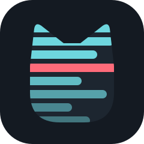
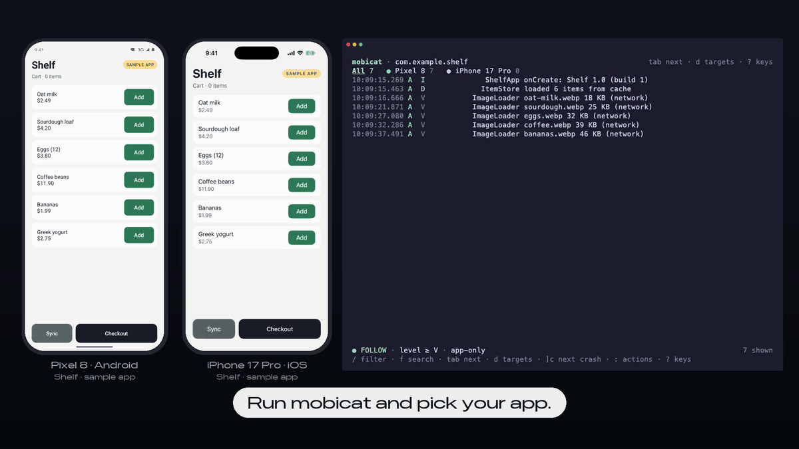

# mobicat

[](https://github.com/yamamoto7/mobicat/actions/workflows/ci.yml)
[](LICENSE)

**Android と iOS のログを、1つの道具で。同じキー、同じ絞り込みで、ターミナルから。**

mobicat は、Android の端末とエミュレータ、iOS シミュレータから、自分のアプリのログだけを表示します。OS が出すノイズは出しません。クラッシュはスタックトレースごと、目立つように出します。どちらの OS でも使い方は同じなので、覚えるのは一度だけです。コーディングエージェントからも使えます。

[English](README.md)



## なぜ mobicat か

- **両方の OS で作っているなら**：Android Studio の Logcat と Xcode のコンソールは、別々の道具で、絞り込みの書き方も違います。mobicat なら1つで済みます。`Tab` で Pixel と iPhone を切り替えられ、同じ絞り込みが両方に効きます。
- **iOS だけなら**：シミュレータには pidcat にあたるものがありません。`log stream --predicate` を手で書く代わりに、`mobicat com.example.app` で済みます。
- **AI エージェントと開発しているなら**：エージェントにも同じものを見せられます。`mobicat com.example.app --last 5m` は直近のログを出して終わるので、Claude Code や Codex、Cursor がクラッシュを読んで直せます。

|  | mobicat | Android Studio の Logcat | Xcode のコンソール | pidcat |
|---|:-:|:-:|:-:|:-:|
| Android | ✓ | ✓ | | ✓ |
| iOS シミュレータ | ✓ | | ✓ | |
| Android と iOS で同じ道具・同じ絞り込み | ✓ | | | |
| ターミナルで動く（SSH 越しでも） | ✓ | | | ✓ |
| コーディングエージェント向け（ログを出して終わる、JSON） | ✓ | | | |

## 特徴

- **自分のアプリだけ**：Android はアプリの UID、iOS は実行ファイルでログを取ります。OS が出すノイズは最初から隠します（`a` で全部表示）。再起動しても見失わず、`── process started (pid N) ──` の行で区切ります。
- **クラッシュが目立つ**：Java / Kotlin の例外、ネイティブのクラッシュ、Swift の Fatal error、キャッチされなかった例外を、スタックトレースごと赤い `✖ CRASH` の塊にまとめます。`]c` で次のクラッシュへ飛べます。見ていない端末で起きたクラッシュは、その端末のタブに印が付きます。
- **両方の OS で同じ使い方**：つながっているすべての Android 端末と起動中のシミュレータで、キーも絞り込みの書き方もクラッシュの見え方も同じです。`Tab` で切り替え、All タブでまとめて見られます。
- **コーディングエージェントから使える**：`--last 5m` と `--for 30s` はログを出して終わります。1行ずつのテキストか、NDJSON（`--json`）で出せます。[Claude Code のプラグイン](docs/agents.md#claude-code-plugin)を入れると、Claude がいつ使えばよいかを覚えます。詳しくは [Using mobicat from a coding agent](docs/agents.md)（英語）を見てください。
- **Android Studio と同じ絞り込みの書き方**：`tag:OkHttp level:warn -tag:Chatty` に加えて、`subsystem:`、`os:`、`fw:rn`、`age:5m` なども使えます。打つたびに結果が変わり、補完と履歴もあります。
- **クロスプラットフォームのフレームワーク**：React Native、Flutter、Kotlin Multiplatform、Capacitor のログを見分けます（クエリの `fw:`）。

## インストール

```sh
# Homebrew（macOS、Linux）
brew trust --tap yamamoto7/tap   # Homebrew 6 以降は、先に tap を信頼する必要があります
brew install yamamoto7/tap/mobicat

# シェルのインストーラ（macOS、Linux）
curl --proto '=https' --tlsv1.2 -LsSf https://github.com/yamamoto7/mobicat/releases/latest/download/mobicat-installer.sh | sh

# PowerShell のインストーラ（Windows）
powershell -ExecutionPolicy Bypass -c "irm https://github.com/yamamoto7/mobicat/releases/latest/download/mobicat-installer.ps1 | iex"

# cargo-binstall（ビルド済みのバイナリ）
cargo binstall mobicat

# Cargo（Rust 1.88 以降）
cargo install --locked mobicat
```

あわせて次のものが必要です。

- Android：`adb`（Android SDK の platform-tools）に `PATH` が通っていること
- iOS：macOS と Xcode（`xcrun simctl`）。今はシミュレータだけで、iOS の実機にはまだ対応していません。

Claude Code では、プラグインを入れると mobicat を使う skill が加わります（先に mobicat 本体を入れてください）。

```
/plugin install mobicat --marketplace yamamoto7/mobicat
```

## 使い方

```sh
# つながっている端末に入っているアプリから選ぶ
mobicat

# 両方の OS で同じ ID のとき
mobicat com.example.app

# OS ごとに ID が違うとき
mobicat --android com.example.app --ios com.example.App

# アプリを起動し直して、起動直後のログから取る（iOS は print() の出力も取る）
mobicat com.example.app --launch

# 直近5分のログを出して終わる（スクリプトやエージェント向け）
mobicat com.example.app --last 5m

# クラッシュだけを JSON で
mobicat com.example.app --last 10m --json -q 'is:crash' | jq -r .message

# アプリを起動し直して、起動から20秒のログを取る
mobicat com.example.app --launch --for 20s

# pidcat の引数も使える（最低レベル、出す／隠すタグ、端末）
mobicat com.example.app -l W -t OkHttp -i Chatty -s emulator-5554

# 保存したログを読む（logcat のテキストか log stream の ndjson）
mobicat --file saved.log

# つながっている端末と起動中のシミュレータを一覧する
mobicat devices
```

### キー

| キー | 働き |
|---|---|
| `j` `k` / `↓` `↑` | 移動（上へ動かすと一時停止） |
| `Space` | 一時停止／再開 |
| `g` / `G` | いちばん古い行へ／最新を追う |
| `]c` `[c` | 次／前のクラッシュ（`]e` はエラー、`]w` は警告） |
| `Tab` / `Shift-Tab` | 次／前の対象（All、端末） |
| `d` | 対象の一覧：All、OS ごと、端末ごと、アプリの切り替え |
| `/` | 絞り込みのクエリ |
| `f` `n` `N` | 検索、次、前 |
| `t` | tag や subsystem を選んで絞る |
| `a` | app-only のオン／オフ |
| `+` `-` | 最低レベルを上げる／下げる |
| `Enter` | 詳細ペイン |
| `y` `V` `Y` | 1行／範囲／表示中の全部をコピー |
| `Ctrl-s` | 表示中の全部をファイルに保存 |
| `:` | 操作を名前で探して実行 |
| `?` | すべてのキー |
| `Esc` / `q` | 開いているものを閉じる |
| `Ctrl-C` `Ctrl-C` | 終了 |

### 絞り込みのクエリ

| クエリ | 一致するもの |
|---|---|
| `timeout` | メッセージに「timeout」を含む |
| `tag:OkHttp` | tag に「OkHttp」を含む |
| `-tag:Chatty` | その tag を除く |
| `tag~:^Net.*` | 正規表現 |
| `level:warn` | warn 以上 |
| `subsystem:` `category:` | iOS の `os_log` の項目 |
| `os:android` `os:ios` | 片方の OS |
| `is:crash` | クラッシュの塊 |
| `fw:rn` | React Native（ほかに `flutter`、`kmp`、`capacitor`、`native`） |
| `age:5m` | 直近5分 |

同じキーが並ぶと OR、違うキーは AND になります。`|`、`&`、カッコも使えます。クエリに大文字が含まれるときだけ、大文字と小文字を区別します。

## 設定

`~/.config/mobicat/config.toml` を読み、次に今いるディレクトリから上へたどって最初に見つかった `.mobicat.toml`（チームで共有する用）を読みます。コマンドのフラグはどちらよりも優先されます。読んだ内容は `mobicat config` で確かめられます。

```toml
app = "com.example.app"

[defaults]
level = "debug"
query = "-tag:Chatty"

[profiles.net]              # 書いた順に 1〜9 キー、または -p net
query = "tag:OkHttp | subsystem:network"

[noise.android]
tags = ["MyNoisyLib"]       # 隠す tag を足す
keep = ["Choreographer"]    # 既定で隠す tag を表示に戻す
```

## しくみ

- **Android**：端末ごとに `adb logcat --uid <アプリの UID>` を使います。再起動で PID が変わっても UID は変わらないので、アプリのプロセスの行を追い続けられます。どのアプリでも出るフレームワークの tag は隠し、アプリ自身の tag や同梱の SDK のログは残します。
- **iOS シミュレータ**：`xcrun simctl spawn <udid> log stream --style ndjson` を、アプリの実行ファイルで絞って使います。`.app` の中のコードが出した行、subsystem が bundle ID で始まる行、React Native の行、Swift の実行時ライブラリの行を、アプリ自身のログとして扱います。
- 複数行のメッセージ（スタックトレース）は1件にまとめ、OS ごとのクラッシュの形に印を付けます。

詳しくは、[requirements](docs/requirements.md)、[architecture](docs/architecture.md)、[technical notes](docs/technical-notes.md)、[coding agents](docs/agents.md)（いずれも英語）を見てください。

## 今後の予定

アプリがどこで動いていても、そのログを拾えるようにしていきます。

- iOS の実機への対応
- 扱えるログを増やす（iOS のクラッシュレポート、Android のバグレポートなど）
- MCP を使いたいエージェント向けの MCP サーバー

アイデアや不具合の報告は [issues](https://github.com/yamamoto7/mobicat/issues) へどうぞ。日本語でもかまいません。

## 開発に参加する

[CONTRIBUTING.md](CONTRIBUTING.md) を見てください（英語）。上のデモは、[`demo/`](demo/README.md) にあるサンプルアプリ Shelf と、同じ場所のスクリプトで撮っています。

## 謝辞

mobicat は「両方の OS で使える [pidcat](https://github.com/JakeWharton/pidcat)」を目指して作り始めました。絞り込みの書き方は Android Studio の Logcat にならっています。

## ライセンス

[Apache-2.0](LICENSE)
