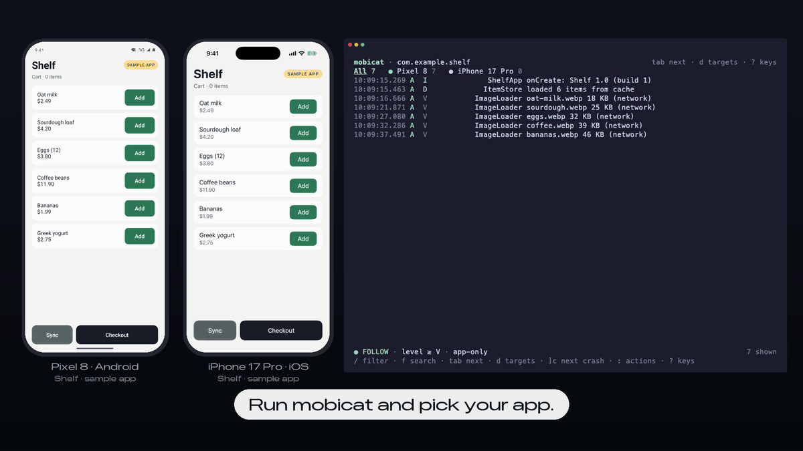

# mobicat

[](https://github.com/yamamoto7/mobicat/actions/workflows/ci.yml)
[](LICENSE)

**One log viewer for Android and iOS. Same keys, same filters, in your terminal.**

mobicat shows only your app's logs from Android devices, emulators and iOS simulators, with the system noise left out. Crashes come first, with the whole stack trace. It works the same on both platforms, so you learn it once. Your coding agent can use it too.

[日本語](README.ja.md)



## Why mobicat

- **Building for both platforms?** Logcat and the Xcode console are two tools with two ways to filter. mobicat is one: press `Tab` to switch between your Pixel and your iPhone, and the same filter works on both.
- **iOS only?** The simulator has no pidcat. You can write `log stream --predicate` by hand, or run `mobicat com.example.app`.
- **Working with an AI agent?** Give it the same view. `mobicat com.example.app --last 5m` prints what happened and exits, so Claude Code, Codex or Cursor can read the crash and fix it.

|  | mobicat | Android Studio Logcat | Xcode console | pidcat |
|---|:-:|:-:|:-:|:-:|
| Android | ✓ | ✓ | | ✓ |
| iOS simulator | ✓ | | ✓ | |
| Same tool and filters on Android and iOS | ✓ | | | |
| Runs in a terminal, works over SSH | ✓ | | | ✓ |
| Made for coding agents (exits with the logs, JSON) | ✓ | | | |

## Features

- **Your app only.** Android logs are taken by the app's UID, iOS logs by its executable. System noise is hidden by default (`a` shows everything). Restarts don't lose the app; a `── process started (pid N) ──` line marks them.
- **Crashes stand out.** Java/Kotlin exceptions, native crashes, Swift fatal errors and uncaught exceptions are grouped into one red `✖ CRASH` block with the stack trace. `]c` jumps to the next one. A crash on a device you aren't looking at shows up on its tab.
- **The same on both platforms.** One set of keys, one filter syntax and one crash view for every connected Android device and booted simulator. `Tab` switches between them; the All tab shows them together.
- **Ready for coding agents.** `--last 5m` and `--for 30s` print and exit, as plain lines or NDJSON (`--json`). A [Claude Code plugin](docs/agents.md#claude-code-plugin) teaches Claude when to use them. See [Using mobicat from a coding agent](docs/agents.md).
- **Android Studio filter syntax.** `tag:OkHttp level:warn -tag:Chatty`, plus `subsystem:`, `os:`, `fw:rn`, `age:5m` and more. Results update as you type, with completion and history.
- **Cross-platform frameworks.** React Native, Flutter, Kotlin Multiplatform and Capacitor logs are recognized (`fw:` in queries).

## Install

```sh
# Homebrew (macOS, Linux)
brew trust --tap yamamoto7/tap   # Homebrew 6 and later ask you to trust a tap first
brew install yamamoto7/tap/mobicat

# Shell installer (macOS, Linux)
curl --proto '=https' --tlsv1.2 -LsSf https://github.com/yamamoto7/mobicat/releases/latest/download/mobicat-installer.sh | sh

# PowerShell installer (Windows)
powershell -ExecutionPolicy Bypass -c "irm https://github.com/yamamoto7/mobicat/releases/latest/download/mobicat-installer.ps1 | iex"

# From source (Rust 1.88 or later)
cargo install --locked --git https://github.com/yamamoto7/mobicat mobicat
```

You also need:

- Android: `adb` (Android SDK platform-tools) on your `PATH`.
- iOS: macOS with Xcode (`xcrun simctl`). Simulators only for now; physical iOS devices are not supported yet.

For Claude Code, the plugin adds a skill that runs mobicat for you (install the command first):

```
/plugin install mobicat --marketplace yamamoto7/mobicat
```

## Usage

```sh
# Choose an app installed on the connected devices
mobicat

# Same ID on both platforms
mobicat com.example.app

# Different IDs per platform
mobicat --android com.example.app --ios com.example.App

# Restart the app and capture its startup (on iOS, also print() output)
mobicat com.example.app --launch

# The last 5 minutes, then exit (for scripts and agents)
mobicat com.example.app --last 5m

# Only crashes, as JSON
mobicat com.example.app --last 10m --json -q 'is:crash' | jq -r .message

# Restart the app and capture its startup for 20 seconds
mobicat com.example.app --launch --for 20s

# Read a saved log (logcat text or `log stream` ndjson)
mobicat --file saved.log

# List connected devices and booted simulators
mobicat devices
```

### Keys

| Key | Action |
|---|---|
| `j` `k` / `↓` `↑` | Move (moving up pauses) |
| `Space` | Pause / resume |
| `g` / `G` | Oldest / follow the newest |
| `]c` `[c` | Next / previous crash (`]e` errors, `]w` warnings) |
| `Tab` / `Shift-Tab` | Next / previous target (All, devices) |
| `d` | Target list: All, per OS, per device, change app |
| `/` | Filter query |
| `f` `n` `N` | Search, next, previous |
| `t` | Pick a tag or subsystem |
| `a` | App-only on / off |
| `+` `-` | Raise / lower the minimum level |
| `Enter` | Detail pane |
| `y` `V` `Y` | Copy entry / range / everything shown |
| `Ctrl-s` | Save everything shown to a file |
| `:` | All actions by name |
| `?` | All keys |
| `Esc` / `q` | Close what is open |
| `Ctrl-C` `Ctrl-C` | Quit |

### Filter queries

| Query | Matches |
|---|---|
| `timeout` | Message contains "timeout" |
| `tag:OkHttp` | Tag contains "OkHttp" |
| `-tag:Chatty` | Excludes the tag |
| `tag~:^Net.*` | Regular expression |
| `level:warn` | Warn and above |
| `subsystem:` `category:` | iOS `os_log` fields |
| `os:android` `os:ios` | One platform |
| `is:crash` | Crash blocks |
| `fw:rn` | React Native (`flutter`, `kmp`, `capacitor`, `native`) |
| `age:5m` | The last 5 minutes |

The same key twice means OR, different keys mean AND. `|`, `&` and parentheses are also supported. Matching is case-insensitive unless the query contains an uppercase letter.

## Configuration

mobicat reads `~/.config/mobicat/config.toml` and then the nearest `.mobicat.toml` up from the current directory (to share with your team). Command-line flags win over both. `mobicat config` shows what was loaded.

```toml
app = "com.example.app"

[defaults]
level = "debug"
query = "-tag:Chatty"

[profiles.net]              # keys 1–9 in the order written, or -p net
query = "tag:OkHttp | subsystem:network"

[noise.android]
tags = ["MyNoisyLib"]       # hide more tags
keep = ["Choreographer"]    # show a tag hidden by default
```

## How it works

- **Android:** `adb logcat --uid <app uid>` for each device, so lines from the app's processes are kept across restarts (the UID stays the same; the PID does not). Framework tags that every app emits are hidden; your own tags and bundled SDKs are not.
- **iOS simulator:** `xcrun simctl spawn <udid> log stream --style ndjson` filtered by the app's executable. A line is the app's own when it comes from code inside the `.app` bundle, from a subsystem that starts with the bundle ID, from React Native, or from the Swift runtime.
- Multi-line messages (stack traces) are grouped into one entry, and crash patterns for each platform are marked.

More detail: [requirements](docs/requirements.md), [architecture](docs/architecture.md), [technical notes](docs/technical-notes.md), [coding agents](docs/agents.md).

## Roadmap

mobicat should pick up your app's logs wherever it runs.

- Physical iOS devices
- More kinds of logs, such as iOS crash reports and Android bug reports
- An MCP server for agents that prefer one

Ideas and bug reports are welcome in [issues](https://github.com/yamamoto7/mobicat/issues).

## Contributing

See [CONTRIBUTING.md](CONTRIBUTING.md). The demo above is recorded with Shelf, a sample app in [`demo/`](demo/README.md), and the scripts next to it.

## Acknowledgements

mobicat started as "[pidcat](https://github.com/JakeWharton/pidcat), for both platforms". Its filter syntax follows Android Studio's Logcat.

## License

[Apache-2.0](LICENSE)
